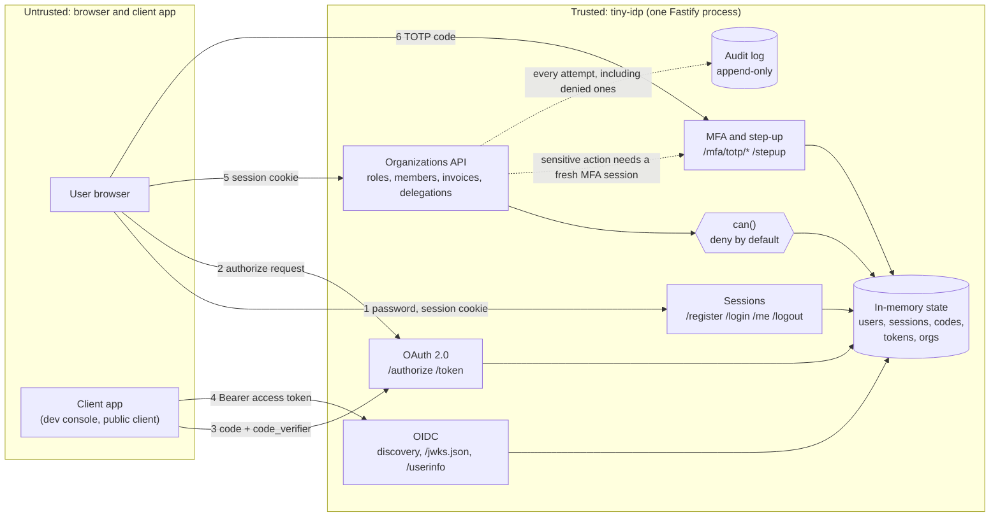
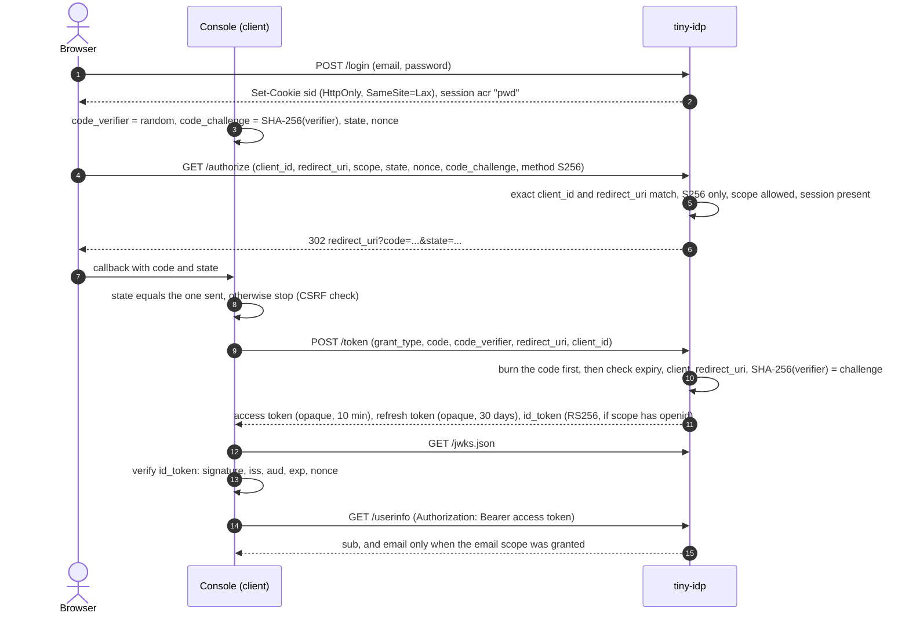

# Architecture

tiny-idp is a small identity provider written to understand authentication and authorization from
the inside. This document answers three questions: what the pieces are, what can go wrong, and
which trade-offs were taken on purpose. It is meant to be read in about five minutes.

It is a **learning project, not a product**. Everything lives in memory, there is one hardcoded
OAuth client, and the list of things deliberately left out is in
[Scope and honesty](#scope-and-honesty).

## Overview

One Fastify process exposes every endpoint. The only caller that is trusted is the server itself:
everything that crosses the boundary below (cookies, query strings, bodies, headers, tokens) is
treated as hostile until it is validated.

### Authorization Code flow with PKCE

The flow the dev console performs against the server. The `code_verifier` never leaves the client
until the last step, which is what makes a stolen `code` useless on its own.

## Components

Each component is a folder under `src/` and owns one question. The routes are thin: they validate
input with Zod, call into the component and shape the response.

- **Sessions** ([src/auth](src/auth), [controllers/auth](src/http/controllers/auth)): registration,
  login and logout. Passwords are argon2id hashes. A login creates a server-side session
  referenced by the `sid` cookie; the session also records `acr` (`pwd` or `mfa`) and `authTime`.
  `requireUser` resolves the cookie to a user for every authenticated route.
- **OAuth 2.0** ([src/oauth](src/oauth), [controllers/oauth](src/http/controllers/oauth)):
  `/authorize` and `/token` for one public client. Authorization Code with mandatory PKCE,
  single-use codes, opaque access and refresh tokens grouped in a family so a whole chain can be
  revoked at once. `requireBearer` guards resources that accept access tokens.
- **OpenID Connect** ([src/oidc](src/oidc), [controllers/oidc](src/http/controllers/oidc)): the
  discovery document, the JWKS, RS256 ID tokens signed by hand with `node:crypto`, and
  `/userinfo`, whose claims depend on the granted scopes.
- **Authorization** ([src/authz](src/authz), [controllers/orgs](src/http/controllers/orgs)):
  organizations are tenants; roles are customer data built from a fixed permission catalog. A
  single pure function, `can()`, decides every question and answers *why* it said yes (own role or
  a delegation and whose). Delegation is temporary, revocable and cannot be passed on.
- **MFA and step-up** ([src/lib/totp.ts](src/lib/totp.ts), [src/auth/mfa.ts](src/auth/mfa.ts),
  [src/authz/step-up.ts](src/authz/step-up.ts), [controllers/mfa](src/http/controllers/mfa)):
  TOTP enrollment and verification, and the RFC 9470 challenge that approving a large invoice
  triggers when the session is not `mfa` or is older than 300 seconds.
- **Audit** ([src/audit](src/audit), [audit-routes.ts](src/http/controllers/orgs/audit-routes.ts)):
  one function, `audit()`, appends an immutable event per org. Routes record successes and also
  refusals. The only HTTP surface is a read.
- **Cross-cutting** ([src/http](src/http)): `HttpError` plus one error handler (clients only see
  stable error codes), `parseBody` (every input goes through a schema), and a sanitized
  `X-Request-Id` that ties responses to audit events.

The **dev console** in `console/` is not part of the identity provider. It is a separate process
that plays the OAuth client and a control panel, and it must never be deployed.

## Threat model

The method is the four questions of the
[OWASP Threat Modeling Cheat Sheet](https://cheatsheetseries.owasp.org/cheatsheets/Threat_Modeling_Cheat_Sheet.html):
what are we working on (the diagrams above), what can go wrong (STRIDE, below), what are we going
to do about it, and did we do a good enough job (the last paragraph of this section).

Every mitigation names the place in the code. A row that says **not done** is an open risk, and it
is repeated in [Scope and honesty](#scope-and-honesty).

| STRIDE | Threat | Mitigation | Where in the code |
| --- | --- | --- | --- |
| Spoofing | An authorization code is stolen and redeemed by someone else | PKCE with S256 only, so the redeemer must know the `code_verifier`; the code is single use, lives 60 s, is bound to client and `redirect_uri`, and is burned before any other check so failed attempts cannot be retried; a second use revokes what the code issued | `exchangeAuthorizationCode` in [grants.ts](src/oauth/grants.ts), `verifyPkce` in [pkce.ts](src/oauth/pkce.ts), `issueAuthorizationCode` in [tokens.ts](src/oauth/tokens.ts) |
| Spoofing | The victim is sent to an attacker's `redirect_uri` (open redirect) | Exact string match with the registered URI; an invalid `client_id` or `redirect_uri` fails with 400 and never redirects | `GET /authorize` in [oauth/routes.ts](src/http/controllers/oauth/routes.ts), `findClient` in [clients.ts](src/oauth/clients.ts) |
| Spoofing | CSRF on the callback: the attacker makes the client redeem the attacker's code | The server echoes `state` unchanged (capped at 512 characters) and the client must compare it. The server cannot enforce this half: the console does and shows the result | `GET /authorize` in [oauth/routes.ts](src/http/controllers/oauth/routes.ts), `stateOk` in [console/index.html](console/index.html) |
| Spoofing | Session fixation, or a session id captured before the user gained more privilege | Login destroys any `sid` that arrived with the request and issues a new one; step-up rotates the id again; the cookie is `HttpOnly`, `SameSite=Lax` and `Secure` in production; expiry is enforced on the server and logout deletes the session there | `POST /login` in [auth/routes.ts](src/http/controllers/auth/routes.ts), `elevateSession` and `setSessionCookie` in [sessions.ts](src/auth/sessions.ts) |
| Spoofing | A stolen refresh token is replayed | Rotation: each refresh token works once; seeing a used one again revokes the whole family, which kills the thief's and the owner's tokens | `refreshTokenGrant` in [grants.ts](src/oauth/grants.ts), `revokeFamily` in [tokens.ts](src/oauth/tokens.ts) |
| Spoofing | An ID token is presented as an access token (token type confusion) | Access tokens are opaque random values looked up in server state, so a JWT never matches; the ID token's `aud` is the client, not an API | `findAccessToken` in [tokens.ts](src/oauth/tokens.ts), `requireBearer` in [require-bearer.ts](src/http/require-bearer.ts), `createIdToken` in [id-token.ts](src/oidc/id-token.ts) |
| Tampering | ID token claims are altered or the token is forged | RS256 signature over header and payload; the algorithm is fixed by the server, not read from the token; only the public key is published | `signJwt` in [jwt.ts](src/oidc/jwt.ts), `getJwks` in [keys.ts](src/oidc/keys.ts) |
| Repudiation | A sensitive or delegated action cannot be attributed, or is denied afterwards | Every approval, denial and step-up challenge becomes an immutable event with `actor`, `on_behalf_of` (taken from `can()`) and `request_id`; there is no route that edits or deletes events. **Partial**: no hash chain, so tampering by someone with process access would go unnoticed | `audit` and `denied` in [audit.ts](src/audit/audit.ts), [audit-routes.ts](src/http/controllers/orgs/audit-routes.ts) |
| Information disclosure | Passwords leak from the store or from responses | argon2id with a per-hash salt; users are exposed through a field-by-field view so the hash cannot slip out; passwords and secrets are never logged or audited | [passwords.ts](src/auth/passwords.ts), `toPublicUser` in [auth/routes.ts](src/http/controllers/auth/routes.ts) |
| Information disclosure | Login reveals which emails are registered | The same 401 for unknown email and wrong password, and a verification against a dummy hash so both take the same time. **Gap**: `/register` still answers 409 for a taken email | `DUMMY_HASH` in [passwords.ts](src/auth/passwords.ts), `POST /login` in [auth/routes.ts](src/http/controllers/auth/routes.ts) |
| Denial of service | Online guessing of the 6-digit TOTP code | At most 5 wrong codes, then 429 with `Retry-After` for 60 s; while locked even the right code is refused; only the current step and one on each side are accepted | `checkTotpCode` in [mfa.ts](src/auth/mfa.ts), `verifyTotp` in [totp.ts](src/lib/totp.ts) |
| Denial of service | Password guessing and credential stuffing against `/login` | **Not done.** Only the cost of argon2id slows each attempt; there is no per-account or per-IP limit | none |
| Elevation of privilege | Reading or changing another tenant's data (BOLA / IDOR) | Every route resolves the org from the URL and requires membership; lookups go through `org.invoices`, never a global map; a non-member and a foreign invoice both answer 404 so existence is not confirmed | `getOrg` in [org-context.ts](src/http/org-context.ts), [invoice-routes.ts](src/http/controllers/orgs/invoice-routes.ts) |
| Elevation of privilege | A user creates a stronger role, or assigns a role above their own | Permission check first, then a ceiling: nobody can grant a permission their own role does not hold; the same ceiling applies to the member being changed | `holdsAll` in [can.ts](src/authz/can.ts), [orgs/routes.ts](src/http/controllers/orgs/routes.ts) |
| Elevation of privilege | A delegation outlives its purpose or is passed along a chain | Mandatory expiry (at most 7 days), revocation, the grantor's permission is re-checked at decision time, and only permissions held through the user's own role can be delegated | `can` in [can.ts](src/authz/can.ts), [delegation-routes.ts](src/http/controllers/orgs/delegation-routes.ts) |
| Elevation of privilege | A stolen password-only session approves a large payment | Approving 1000.00 or more needs an `mfa` session no older than 300 s, enforced on the server and after the permission check; the 401 carries the RFC 9470 challenge | `hasFreshMfa` and `stepUpChallenge` in [step-up.ts](src/authz/step-up.ts), approve in [invoice-routes.ts](src/http/controllers/orgs/invoice-routes.ts) |
| Elevation of privilege | A captured TOTP code is replayed, or a stolen session swaps in the attacker's authenticator | The last accepted time step is stored and codes at or below it are refused; enrolling again while a factor is active answers 409 | `verifyTotp` in [totp.ts](src/lib/totp.ts), `/stepup` and `/mfa/totp/enroll` in [mfa/routes.ts](src/http/controllers/mfa/routes.ts) |

Did we do a good enough job? For the flows above, mostly yes: the acceptance tests in `test/` (and
the red buttons in the dev console) attack most of these mitigations. For the system as a whole,
no, and the table says where: the **not done**, **partial** and **gap** rows are the honest answer.

## Decisions and trade-offs

Each item says what was chosen, what was given up, and why.

1. **In-memory state instead of a database.** Every map in [store.ts](src/store.ts) disappears on
   restart. Chosen to keep the project about identity logic and the tests fast. Cost: nothing
   survives a restart, nothing scales past one process, and there is no atomicity beyond "one
   synchronous run of JavaScript". That last property is actually relied on (single-use codes and
   TOTP steps), so a real database would need transactions or `UPDATE ... WHERE used = false`.
2. **Opaque access and refresh tokens instead of JWT access tokens.** Revoking a family takes
   effect on the next request because every call looks the token up. Cost: every resource call
   reads server state and a separate API cannot verify tokens offline. The ID token is still a
   JWT, because its job is to be verified by the client.
3. **Short access tokens (10 min) with refresh rotation instead of long-lived tokens plus a
   denylist.** Revocation needs no extra state on the hot path. Cost: more refresh traffic and
   a window of up to 10 minutes in which a stolen access token still works.
4. **One public client, PKCE only, consent granted automatically.** There is no client secret to
   leak and no consent screen to build. Cost: it cannot model third-party apps, confidential
   clients or user consent.
5. **`404` instead of `403` for non-members and for other people's invoices.** The response never
   confirms that a resource exists in another tenant. Cost: harder to debug, and the status code
   is no longer a reliable hint of "authenticated but not allowed".
6. **Deny by default, roles as data and permissions as code.** An unknown permission fails safe,
   and customers can define their own roles without changing the product. Cost: every new
   permission needs a code change, and the ceiling check (`holdsAll`) has to be remembered by
   every route that grants something.
7. **Delegation evaluated at decision time.** A delegation records what is lent, but it works
   only while the grantor's own role still holds those permissions, so no cleanup job is needed.
   Cost: `can()` scans delegations linearly on every check.
8. **Step-up bound to the browser session, not to the token.** The approve route reads `acr` and
   `authTime` from the session cookie. This implements the resource-server half of RFC 9470 (the
   challenge) but not the authorization-server half: `/authorize` ignores `acr_values` and
   `max_age`, and the ID token has no `acr` claim. Cost: a client that only holds a Bearer token
   cannot step up.
9. **Permission before step-up, and before the existence check, on approve.** The 401 teaches a
   client how to reauthenticate, so a user who can never approve must not be invited to do MFA,
   and must not learn which invoice ids exist. Cost: the order differs from checking existence
   first, and a denied request is recorded even for ids that do not exist.
10. **The session id is rotated on step-up.** An id captured while the session was weaker is
    worthless afterwards. Cost: a client holding the old cookie is logged out and must follow
    `Set-Cookie`.
11. **TOTP as the tested second factor, passkeys only as a first step.** TOTP can be tested end to
    end from HTTP. Cost: TOTP is phishable, because a code can be relayed in real time. Passkeys
    are the stronger choice, and only the registration options endpoint exists.
12. **An append-only audit by API surface, not by storage.** Events are frozen objects behind a
    single writer and a read-only route. Cost: it protects against mistakes and against clients,
    not against someone who controls the process. A hash chain anchored elsewhere would detect that.
13. **Hand-written JWT, PKCE and TOTP on top of `node:crypto`.** The goal is to be able to explain
    every line. Cost: more risk than an audited library (`jose`, an OTP package). A production
    system should use libraries for exactly these parts.
14. **A new signing key on every boot.** No key storage to protect, and `kid` is already in place
    for rotation. Cost: every token signed before a restart stops verifying.

## Scope and honesty

**Written by hand** (from the specifications, using only `node:crypto` primitives): session
management, PKCE, authorization codes and token families, JWT signing, the JWKS, TOTP and base32,
the `can()` function and the delegation rules, step-up, and the audit log.

**From libraries**: Fastify (HTTP, cookies, form bodies), Zod (input validation), `Bun.password`
(argon2id) and Biome (lint and format).

**Deliberately left out, as known risks:**

- No rate limiting anywhere except the TOTP lock. Login, registration and `/token` are open to
  guessing and flooding.
- All state is in memory, tokens and TOTP secrets are stored in the clear inside that memory, and
  used authorization codes are never removed.
- The signing key is regenerated on every boot and cannot be rotated.
- No CSRF tokens (the defense is `SameSite=Lax`), no CORS policy and no HTTPS enforcement; `Secure`
  cookies only switch on with `NODE_ENV=production`.
- No token revocation or introspection endpoints, and logging out does not revoke OAuth tokens.
- The last owner of an org can demote themselves, and there is no way to remove a member.
- Audit events have no hash chain, do not record `delegation_id`, and role changes are not audited.
- No backup codes or recovery flow for a lost authenticator, no passkey verification, no email
  verification and no password change or reset.
- Not built at all: step-up through `/authorize` (`acr_values`, `max_age`), token exchange
  (RFC 8693), multi-region operation and keys held in an HSM.
